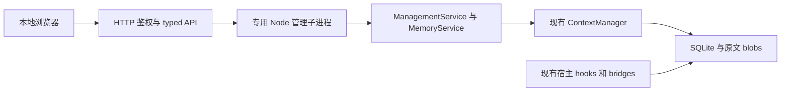

# CMM 本地管理面板功能与实施方案

日期：2026-10-09。对象：当前源码版本 0.3.0-rc.2、schema v4。使用形式：已确认采用本地浏览器面板。

首版应以实时运行看板为首页，让用户看清整条 CMM 链路的当前活动、服务健康和异常，再进入证据、模型与配置管理。现有内核可以复用，但不能把命令行输出直接包成网页接口。建议以六个导航入口交付完整的本地管理闭环，先建立只读能力，再开放少量明确的管理写入。

## 首版功能

| 入口 | 功能 | 用户能完成的操作 |
| --- | --- | --- |
| 实时看板 | 整体状态、链路节点、当前活动、模型调用、最近事件和异常；当前存储、Agent、工作区；归档与索引摘要 | 一眼辨认正在做什么、哪些环节正常、哪里失败或缺少观测，并进入对应详情 |
| 记忆库 | 搜索与筛选、游标分页；详情中的原文、胶囊、评分、决策、保护和投影；原文查找与下载 | 从摘要追到原文，定位长日志中段，固定重要证据，复制对应 MCP 召回参数 |
| 会话与链 | 工具证据会话列表、事件时间线、关联链及成员、链胶囊、已存在的投影记录 | 还原调查、修改、验证的工具证据过程，查看哪些记录被关联或生成过候选视图 |
| 模型与调用 | retention/capsule/chain 三种角色、Provider 顺序、凭据状态、模型与地址；全存储调用记录、成功失败、记录的 tokens | 配置本地 Clef 和远程 DeepSeek，明确谁负责评分、摘要和关联，按需测试连接 |
| 策略与接入 | 策略预设、captureOnly、适用宿主的 ingress 设置；各宿主能力、受管配置匹配、捕获观测与重载说明 | 查看和调整行为，分清已保存配置、当前面板配置与宿主已采用配置 |
| 诊断 | 环境版本、可解释错误、手动原文与回执校验、SQLite 检查、索引重建、脱敏诊断摘要 | 排查归档、索引、模型和接入问题，保留检查时间及作用范围 |

### 实时看板作为首页

首页采用四层布局：顶部整体状态与范围，中部工作链路与组件卡片，下部当前活动及滚动事件流，底部轻量趋势和资源摘要。每条状态显示更新时间、信息来源和可点击的诊断入口；用文字和图标配合颜色，不只靠红绿区分。

| 区域 | 展示内容 | 数据来源和限制 |
| --- | --- | --- |
| 整体状态 | 正常待命、工作中、部分异常、连接中断、观测不足；选定 storage/agent/workspace | 汇总组件信号；页面与后台断开时冻结旧值并显示过期时间，不沿用旧绿色状态 |
| 工作链路 | 工具结果捕获 → 精确归档 → 索引/链关联 → 条件触发的评分与胶囊 → 支持宿主的候选投影 → 搜索/召回 | 显示真实阶段事件，条件分支不会画成每次必经；Codex/Kimi 投影节点标为 native 不支持 |
| 组件卡片 | 面板服务、管理进程、SQLite/原文存储、宿主接入、本地 Clef、远程 DeepSeek | 各组件使用自己的观测方式；宿主最后捕获、服务心跳、模型调用结果不能互相替代 |
| 当前活动 | 正在归档、建立索引、评分、生成胶囊、关联链、校验或重建索引；已运行时长、结果和可取消维护任务 | 当前数据库主要记录完成结果；准确在途状态需要新增轻量 start/end 信号，不从旧完成记录推测 |
| 最近事件和异常 | 采集成功、评分完成、Provider 失败/切换、保守回退、回执发布、配置保存、维护结果 | 只展示有作用域的脱敏元数据；关联事件 ID 可跳详情，滚动流不包含原文、Key 或完整错误体 |
| 轻量趋势 | 看板观测期间的捕获数量、完成调用数、失败数；新增观测支持的耗时分布 | 标注统计窗口与采样范围，重开看板不会伪造历史；已有数据不足以提供精确历史延迟和费用节省趋势 |
| 资源摘要 | CMM 管理进程内存/CPU、选定存储的容量信息；逻辑载荷单独标示 | 使用真实运行采样，不代表全机所有进程；GPU 利用率、显存和 Clef 进程资源待确定可靠采样源后扩展 |

每个节点有独立状态：**工作中、就绪/空闲、异常或保守回退、已确认停止/不可达、数据过期、尚未观测**。没有捕获活动是空闲或未知，不能仅凭旧 `last_seen` 判定宿主离线。一次远程调用成功只支持“最近调用成功”，不代表 DeepSeek 持续在线；本地模型的健康探测也不证明任务质量。

页面活跃时默认约每 2 秒刷新轻量快照，约每 5 至 10 秒检查已配置本地服务的可用性；这些是首版设计目标，须在并发捕获和真实 Windows 环境验证。只访问明确配置的本地健康端点，不扫端口；不自动请求远程付费模型，也不在轮询中执行 verify、reindex、tidy、原文 hash 全量检查或其他写入。后台标签页降频，连接失败退避，刷新不丢失用户选中项。

实时看板以服务端短期环形事件缓冲和带 revision 的快照为基础。断线重连先获取当前快照，再继续增量；发生缓冲缺口时标明缺口，不能装作完整审计历史。首版可用有界轮询；需要降低推送延迟时再采用同样鉴权和作用域的 SSE。刷新机制与采集完全解耦，关闭看板不影响 CMM 捕获。

为了覆盖不同 hooks/bridges 进程，需要增加跨进程的轻量运行观测：组件实例、心跳、操作开始/结束、结果、耗时、已采用配置 revision。只传结构化元数据，不改原文，不承担指令或工具调用转发。短生命周期 hook 不要求常驻，观测失败必须 fail-open，不能让面板不可用拖慢或阻断宿主工具。具体元数据通道在实施时用小样验证延迟、并发和有界清理；首版优先采用独立临时运行状态，避免为展示实时信息提前迁移归档 schema。

没有接入新运行信号的旧进程显示“仅完成记录可见”或“尚未观测”；配置文件已保存、面板已采用、宿主桥接已采用分别显示，不伪造自动重载成功。所有信号保留 source、observedAt、instanceId 和过期策略；没有可靠信息就明确标为未知。

### 记忆详情是首版的重点

详情使用可切换标签，不在列表一次性加载原文：

1. **原文**：input/result 分开，逐页加载、字面查找、UTF-8 下载；显示字段 hash、长度、分页单位与完整性。
2. **胶囊**：摘要、事实、锚点、来源事件、冻结状态；明确是衍生证据，可以跳回来源。
3. **决策**：评分器、安全移出评分、实际保留动作、理由和轮次；不把评分称为记忆质量或重要性。
4. **保护**：事件固定、链保护、近期召回和活动链；取消事件固定后，其他保护可能仍然有效。
5. **投影**：存在的候选视图、表示类型、目标证据会话、hash 验证状态及字符对照；没有回执就显示未记录。

“查看原文”保持只读。“下载原文”导出已验证的捕获文本。首版不使用“恢复到 Agent 上下文”按钮，因为网页展示、设置召回保护和宿主实际消费原文是不同动作。可以复制 `context_recall` 参数，交给对应项目的 Agent 调用。

事件固定作用于该事件的所有会话。解除固定移除该事件的事件级固定，不解除独立的链固定。首版不开放链级固定，避免直接暴露缺少 scope 校验的低层接口。

### 模型管理需要区分角色和作用范围

retention 负责保留评分，capsule 负责摘要细化，chain 负责模糊关联辅助。`systemone` 只能用于 retention；保留 native Clef 配置和当前 DeepSeek 胶囊/链配置的兼容性，不通过一个“默认模型”字段覆盖全部角色。`models.cheapModel` 目前是保留字段，不能作为实际 Provider 选择器。

模型与策略配置作用于选定的整个 storage，而非顶部选中的单个工作区。模型调用账本也属于整个 storage，页面要明确标示。第一版可以按时间、角色、Provider、成功/失败筛选；不能提供没有数据依据的项目费用排行。

Key 输入只允许保持、替换、删除三种动作。浏览器只能看到是否配置及来源，不能取回原 Key。现有 API Key 保持在私有本地配置中，不能写进前端构建变量或静态资源。

连接测试为用户明确触发的独立操作，使用已保存、校验通过的 Provider 配置和固定合成数据，不发送历史归档。测试前区分只检查配置、请求连通性和真实模型 JSON 校验；真实远程请求可能计费，不能在打开页面或轮询时自动发起。测试结果保留时间、模型、阶段、状态和记录的 token，不保存请求凭据或 API 错误体。

## 功能优先级和取舍

| 优先级 | 范围 | 取舍 |
| --- | --- | --- |
| 首版必须交付 | 实时运行首页与六个入口的核心浏览、检索、原文下载、事件固定、模型与常用策略设置、诊断 | 形成日常管理闭环，运行信号真实可追溯 |
| 首版的接入范围 | 已有配置与能力检查、最后观测、重载及宿主信任说明、可复制的现有安装命令 | 先覆盖诊断；不自动授信，也不操作 sandbox |
| 下一阶段增强 | setup/uninstall 变更预览与受控应用、指定 RTK 导入、备份与恢复、GC 候选预览 | 涉及文件或不可逆原文操作，单独完成作用域、计划和恢复设计 |
| 按实际需要增加 | 本地模型启动/停止、硬件状态、更多时间趋势、多存储切换 | 先确定可控制的进程与数据来源；现有项目没有这些管理能力 |
| 暂不纳入 | 对话聊天、任务调度、多用户、远程访问、云同步、自动调参、自动清理、强制压缩 Codex/Kimi | 超出本地证据管理范围；不能以新界面制造宿主没有的能力 |

界面默认中文，支持浅色和深色，使用侧栏、范围选择器、数据表格和详情视图。提供明确的空状态、加载、错误和失效状态；按钮提交期间防重复，数据刷新显示更新时间。长文本分页，列表不随每次轮询失去当前页和选中项。首版用已有真实数据，预览需要的样例必须明确标为演示。

## 已核实的项目基础

当前项目是 TypeScript ESM + Node 内置 SQLite，未提供 HTTP 服务或前端。`ContextManager` 负责归档、保留、胶囊和链；`MemoryService` 提供作用域受限的证据接口；MCP 为 stdio 工具服务。新面板应增加管理层，保留这些接入路径。

| 模块 | 可复用能力 | 面板接入需要注意的事实 |
| --- | --- | --- |
| `src/storage` | 原文、事务、schema v4、WAL、hash 与字节校验 | `Database.open` 会建库和迁移，不是只读查看器；只打开启动时明确选定且兼容的存储 |
| `src/evidence` | 分块搜索、来源、索引覆盖、游标、关联证据 | 搜索不是语义检索；索引有覆盖上限，未命中不能证明原文没有 |
| `src/runtime/memory.ts` | search、recall、pin、status、explain、verify | 复用业务语义，但增加浏览器专用 DTO 和作用域管理 |
| `src/core` | 保留、保护、召回、统计、显式 GC | desired state、估算和真正发布的视图必须分开；GC 作用于整库 |
| `src/capsule`、`src/chains` | 胶囊来源、冻结、规则与模型辅助关联 | 衍生摘要不是原文，链完成不是任务验收 |
| `src/providers`、`src/scoring` | 三类角色、failover、native systemone、usage 记录 | 连接和评分失败使用现有保守边界；不重试上游工具调用 |
| `src/integrations` | hooks、Node bridge、RTK 只读导入、安装预览与回滚 | Codex/Kimi native 捕获，不改历史；OpenCode 历史 transform 仍有 live 验收边界 |
| `src/mcp`、`src/runtime` | stdio、私有 RPC、并发与子进程退出 | 不把私有 bridge 或任意 CLI 命令暴露到浏览器 |
| `scripts`、`tests` | clean build、离线 tarball 安装、Windows hooks、协议与完整性回归 | 需要增加管理 API、静态资源、安装后 HTTP 与浏览器验收 |

当前 `package.json` 为 0.3.0-rc.2；目录名称 rc.1 不代表运行版本。此前 2026-10-09 实测记录为 209 tests、208 pass、0 fail、1 Windows skip，并通过离线打包。本次为源码与交付设计调研，没有重新执行这套测试，也尚无面板运行证据。

### 实现前需要处理的具体缺口

| 缺口 | 源码依据 | 实施处理 |
| --- | --- | --- |
| 列表无稳定管理分页 | `src/cli.ts:119`，现有 diagnostics 最多 200 条 | 提取 typed 查询服务；为会话、事件、链和胶囊加固定排序、游标与参数上限 |
| scores 实际返回 decisions | `src/cli.ts:126` | 分开提供评分记录和决策记录，保留 scorer、理由和轮次 |
| 胶囊列表漏链与会话视图来源 | `src/cli.ts:127`；`src/storage/schema.ts:60,226` | 通过事件、链与 event_views 联合推导访问范围，验证来源事件归属 |
| 索引总览漏旧记录 | `src/runtime/memory.ts:392` | 独立统计无 index manifest 的 legacy 记录，不归类为完整索引 |
| 搜索 offset 是命中块起点 | `src/evidence/search.ts:56` | 打开附近页；准确关键词位置使用 recall 的 find，不把块起点作为高亮词位 |
| 批次数据不是时间序列 | `src/storage/schema.ts:264`；`src/runtime/memory.ts:372` | 展示累计批次次数和最后批次，首版不绘制历史节省趋势 |
| 没有统一在途操作与组件心跳 | `src/runtime/memory.ts:126`；`src/providers/failover.ts:43` | 为准确实时活动补充 start/end/heartbeat 元数据；旧进程无信号时标示未知，不能从最后完成时间推断正在工作 |
| 调用账本没有项目归属 | `src/storage/schema.ts:133`；`src/cli.ts:129` | 标注整库调用记录，不伪造按项目统计；如后续要补归属，再设计迁移 |
| 配置读改写可能覆盖并发修改 | `src/config.ts:123`；`src/cli.ts:108` | CLI 与面板共用锁内重读、revision 比较、patch 合并和原子写入 |
| Provider 等运行组件只在 open 构造 | `src/core/context-manager.ts:113` | 保存和采用分别返回状态；面板排空自身任务后重载，不承诺重启其他宿主 |
| session ID 的输入语义不同 | `src/cli.ts:124,245`；`src/runtime/memory.ts:173` | 管理层使用 archiveSessionId，并查归属；不把 DB ID 再送入 hostSessionId 哈希 |
| unpin 多步写入不在一个事务 | `src/runtime/memory.ts:197` | 事务内重查归属、删事件 pins、同步旗标，覆盖与 capture/GC 并发场景 |
| 部分诊断错误仅截断，非通用脱敏 | `src/runtime/memory.ts:126,386,428` | 浏览器错误返回稳定代码和受控说明；不直接返回完整 status/explain/verify 对象 |
| 打包检查可使用陈旧 dist | `scripts/pack-smoke.mjs:20` | 明确清洁构建前置条件或校验构建 manifest；校验 tarball 中 HTML 及引用资源 |

这些是面板对接需要解决的实际接口或语义问题。现有项目没有公网 HTTP 入口，新增认证、CSRF、CSP 等属于新 HTTP 边界的准入设计，不作为既有网络漏洞报告。

## 数据和界面必须保留的含义

- `hot/capsule/evicted` 表示保留策略的期望视图，不证明宿主当前采用了它。
- 回执和批次描述返回过的候选视图，不证明模型消费、缓存命中或账单下降。
- 逻辑归档字节不是实际磁盘占用。核心 token 节省计数是估算，可能在未发布投影时增长，不能作为“实际节省”主卡片。
- Provider token 字段缺失时也可能记为 0。现有行只能称“记录的 token 数”，不能把所有 0 解释为已知零用量。
- `cost_usd=0` 是未定价占位值；旧记录还可能含历史估价。首版不显示实际花费或免费请求。
- hash 完整性与上游完整性分开。一个记录可以同时 hash 验证成功、来源未知或上游 partial/filtered。
- 普通原文浏览不创建召回保护日志；浏览次数不能冒充 Agent 召回次数。
- 普通工具证据会话不是完整人类对话，链的 completed/frozen 不是任务成功判定。
- 安装文件匹配、宿主批准、捕获观测、MCP 可发现和端到端 live smoke 是不同证据。未检查显示未知，不填绿色成功。

## 技术路线

建议使用 React + TypeScript + Vite 构建静态前端，Node 内置 HTTP 提供本地 API 和资源。React 的官方指引允许使用 Vite 等构建工具建立客户端应用；Vite 可输出生产静态资源，符合现有本地后端形态。前端构建依赖在开发阶段安装，运行包携带 bundle；保留 Node 服务无运行期 npm 依赖的交付目标。[React 官方说明](https://react.dev/learn/build-a-react-app-from-scratch)、[Vite 官方说明](https://vite.dev/guide/)。

前端使用独立的 DOM/JSX tsconfig。现有根 tsconfig 保持 Node 核心与测试编译边界。依赖版本在实施时核验、锁定，不把当前官网版本推定为已安装或已验证。

拟新增入口为 `cmm dashboard --storage <明确选择的存储> --agent <Agent> --workspace <项目> [--port <端口>] [--open]`。这是计划中的命令，当前不可执行。`serve` 继续承担 MCP stdio 服务，不复用为网页服务。

管理子进程避免 `DatabaseSync` 的等待、大原文校验和维护任务阻塞 HTTP 接入线程。复用现有子进程生命周期约束，使用固定入口和 argv、不经过浏览器提供的 shell 字符串。管理协议只接受明确列出的操作；HTTP API 不透传 SQL、命令、路径或私有 bridge 消息。

短查询有并发及队列上限，维护操作按 storage 排队。verify/reindex 返回任务 ID，能报告进度、取消和中断；取消在安全批次边界生效，不承诺立即终止正在执行的 SQLite 调用。服务重启后未完成任务显示中断，不自动重放写入。停止时先拒绝新任务，排空或取消维护，等待子进程 close 和数据库连接关闭。

### 拟新增的管理接口

所有数据 API 需要鉴权。除明示的整库端点外，均需要后端颁发的 scopeId，并在每次访问对象时检查 agent/workspace 归属。

| 接口组 | 主要方法 | 范围与约束 |
| --- | --- | --- |
| 范围与总览 | GET scopes、overview、capabilities | 仅列出启动存储中的已存在工作区；不浏览整机目录，不自动初始化其他库 |
| 实时运行 | GET runtime snapshot、runtime events | 已鉴权、有 scope 的轻量快照与增量；revision、时间戳、来源、过期信息及有界事件缓存；整库调用另行标注 |
| 会话与证据 | GET sessions、events、search、event detail | 新列表默认 50 条、最多 100；已有 search 保持最多 50，游标绑定范围、查询、筛选与排序 |
| 原文 | GET event content、download | 默认分页 12,000、最多 64,000 UTF-16 单位；只读、hash 校验、附件下载，不接受任意磁盘路径 |
| 关联详情 | GET chain、capsule、projection detail | 从已授权来源推导 scope；回执须验证后才能标为 hash 已验证 |
| 事件保护 | POST event pin、unpin | 事件级固定；后端事务内重查，不开放无 scope 校验的链级操作 |
| 模型与设置 | GET config metadata、providers、provider calls；PATCH settings/provider | 配置与调用记录标示整库；凭据 write-only；expectedRevision 防过期覆盖 |
| 模型测试 | POST configured provider test | 只允许已保存 Provider、固定合成输入、明确测试阶段，不接受临时任意 URL |
| 维护 | POST verify/reindex；GET job；POST job cancel | 用户触发，范围固定，进度有界，错误脱敏；刷新页面不会重复提交 |
| 诊断 | GET last checks、environment、redacted diagnostics | 只返回 allowlist 元数据；不开放日志、配置、备份目录下载 |

首版尽量保持 schema v4。新增查询、配置 revision 和短期管理任务无需预先增加账单、历史趋势或持久作业表。若后续功能确实要求迁移，再按既有版本拒绝、完整备份和迁移验收流程单独实施。

### 本地服务的边界

仅监听 `127.0.0.1`，默认自动选择可用端口；严格校验真实 Host 和端口。引导链接使用 fragment 中的一次性高熵令牌，不放 query 或普通日志；兑换短期浏览器会话后立即清除地址栏令牌。所有 API 必须鉴权，写入另需同源 Origin、CSRF 凭据与 JSON content type，关闭跨域 CORS。刷新不应丢失短期会话；不把 Provider Key 存进 localStorage。

原文、搜索片段、胶囊和路径全部作为文本渲染，不执行 HTML、Markdown HTML、ANSI 或归档命令。CSP 限制脚本与资源为打包的本地文件，禁止 framing；不依赖 CDN、远程字体或遥测。API 和原文响应使用 no-store；下载采用附件和安全文件名。[MDN CSP 指引](https://developer.mozilla.org/en-US/docs/Web/HTTP/Guides/CSP)。

列表、详情、诊断和配置分别定义 DTO。不要 `SELECT *` 后把 refs、inline 原文或完整错误塞进浏览器列表。配置地址的显示值去掉 query/hash，Key 状态不用凭据内容推导可显示字符串。后台 HTTP 日志不记录 Authorization、Cookie、请求体、搜索词和原文。

配置保存使用统一的 `updateConfig(patch, expectedRevision)`：跨进程锁内重读、比较 revision、合并、validate、原子发布。CLI 与面板都接入同一路径。文件权限、凭据和未修改字段保持；冲突返回 409，页面重新载入后再确认差异。不要只给网页加锁而让 CLI 继续无条件覆盖。

## 分阶段交付和验收

### 阶段一 可浏览的安全面板

交付新启动入口、HTTP 鉴权、管理子进程、typed DTO、scope、实时首页、轻量运行信号、记忆列表、搜索、原文、胶囊、决策、会话/链和只读模型配置。前端具备现代布局、主题、空状态和错误状态。此阶段已经可使用真实归档，不依赖模型联网。

验收：

- 选错 Agent/workspace、foreign event/chain/capsule/session、伪造或过期游标均拒绝，不泄露其他范围。
- 未鉴权读请求、外部 Host/Origin、路径穿越和 XSS 样例被拒绝或仅作为文本展示。
- 查看、刷新、查找和下载不修改保留状态、保护、召回日志或原文字节。
- 多页 Unicode 原文重组与下载的 UTF-8 hash 一致；BOM、CRLF、NUL 和 partial/filter 标签保留。
- 时间戳并列分页不漏重；新捕获在刷新时出现，不把分页列表说成数据库快照。
- 空库、断网、未配置模型仍能完成浏览闭环；全局指标和未知状态的标签正确。
- 用受控合成运行触发捕获、评分、胶囊、Provider 失败/回退和维护状态，节点与事件流对应实际信号；在约定负载下轻量变化目标为 2 至 3 秒内可见，测得延迟和范围分别记录。
- 验证无活动、旧进程未接入、失去心跳、模型不可达及浏览器断线场景；空闲不误报离线，旧值不冒充实时，无信号不编造进行中状态。
- 看板轮询不产生模型调用或维护写入；观测通道失效、面板关闭、缓冲缺口不破坏捕获、原文或 fail-open 行为。

### 阶段二 日常管理闭环

交付事务化事件固定/解除、模型和常用策略编辑、配置冲突保护、明确触发的模型测试、维护任务、只读接入诊断和脱敏诊断摘要。保存结果同时说明磁盘保存、面板采用及其他宿主待重载状态。

验收：

- 两个面板或 CLI 并发编辑不静默覆盖；非法 patch 保留旧配置字节，Key 保持/替换/删除正确。
- 固定/解除与捕获、GC 并发时没有孤立 pin 或旗标不一致，独立链保护仍生效。
- 打开或轮询页面不触发模型调用；模型测试只发送固定合成输入，失败不泄露 Key/响应体。
- 长校验期间网页能显示任务状态和取消；浏览器刷新不重做任务，退出等待管理进程关闭。
- Codex/Kimi 始终展示 native capture-only 能力；配置开关不制造不存在的历史压缩能力。

### 阶段三 有独立需求再扩展

安装/卸载使用已有 plan/apply、备份和逐文件竞争检查，加短期计划与作用范围说明。GC 先新增候选 planner：固定候选 IDs、配置 revision、预计逻辑载荷和期限；确认只处理计划内仍符合保护条件的事件，变化者跳过，不补入计划外对象。备份恢复覆盖 SQLite/WAL/SHM/blobs，并明确停止相关 writer 的条件。RTK 导入继续保持只读源库与独立来源。

这些功能不作为前两阶段的隐式工作，也不改默认无删除期限。

### 构建与交付门槛

统一 clean → core build → web build，避免旧 clean 脚本删除另一套产物。静态资源使用 `import.meta.url` 定位，进入明确的 package files 白名单。独立 `test:pack` 不能只验证旧 dist；安装真实 tarball 后启动面板，检查首页、引用资源、鉴权、范围及 search → content → download → pin → reopen 链路。

继续运行已有 `npm test` 和 `npm run test:pack`；新增有意义的 HTTP、DTO、配置竞争、权限和下载完整性测试。Windows 验收覆盖 PowerShell 5.1/7、中文和空格路径、端口冲突、启动停止、关库后清理。浏览器验收检查主要六个入口的真实数据、空/错状态、主题和原文安全展示，不用静态构建成功替代可用性结论。

源码构建、离线安装、浏览器可用性、真实宿主接入和任务质量分别记录。前两阶段完成不自动代表已完成 live OpenCode/Bun、实际 token 节省或费用比较。

## 实施文件安排

建议新增 `src/management/` 管理查询/DTO/配置协调，`src/dashboard/` HTTP/会话/路由/worker，`web/` 前端与独立构建配置，以及管理 API/浏览器相关测试。修改 CLI 增加 dashboard 入口，修改 scripts/package files 纳入网页资源；保留现有 hooks、MCP stdio 和核心存储职责。

先解决安全接口、作用域、分页、配置竞争和生命周期，再接入界面。首版不重构归档内核、不新增自动 Agent 功能，也不把私有配置、备份、归档或生成的宿主配置纳入 Git 或包。

## 源码依据

- 核心边界：`AGENTS.md`、`README.md`、`docs/ARCHITECTURE.md`、`docs/INTEGRATIONS.md`、`SECURITY.md`。
- 作用域和证据服务：`src/runtime/memory.ts:21,46,134,141,184,382,398,408`。
- 查询和检索：`src/cli.ts:119`、`src/evidence/search.ts:11`、`src/evidence/index.ts:31`。
- 原文校验和事务：`src/storage/blob-store.ts:18`、`src/storage/sqlite.ts:94,139`、`src/storage/schema.ts:28,133,226,264`。
- 配置和模型：`src/config.ts:123,133`、`src/providers/failover.ts:43`、`src/scoring/systemone.ts:5`。
- 保留和维护：`src/core/context-manager.ts:113,485,604,631`、`src/core/retention.ts:239,406`。
- 安装和退出：`src/integrations/setup.ts:188`、`src/util/child-lifecycle.ts:19`、`src/runtime/rpc-client.ts:18`。
- 构建和既有验证：`package.json:17,39`、`tsconfig.json:5`、`scripts/pack-smoke.mjs:20`、`docs/RELEASE_VALIDATION.md`。

本方案基于本轮读取的当前源码、三条独立只读审计及现有验证日志。旧 release 文档的数字与接入快照属于各自日期，未据此推定当前运行状态；未读取个人原文归档，也未在调研中发起模型调用。产品代码尚未开始实施。
